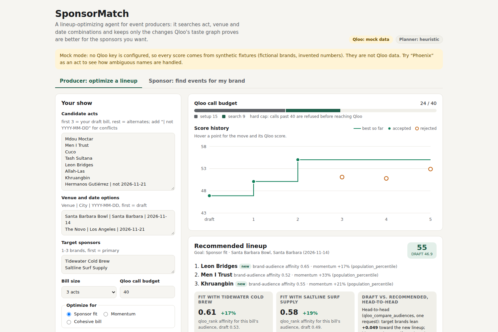

# SponsorMatch

**An agent that books a better show.** Give it the acts you could book, your venue and date options, and the sponsors you want to land. It searches lineup combinations, scores every candidate with Qloo's taste graph, and keeps a change only when Qloo's numbers prove it is better: "swap Cuco for Khruangbin and fit with your coffee sponsor rises 11%."
Brands get the other side: "I have $10K. Which of these events over-index for my audience?"

Built for the [Qloo Agentic Hackathon](https://qloo.devpost.com/). All Qloo access goes through Qloo's official harness, [`@qloo/qloo-harness`](https://github.com/qloo/qloo-hackathon-kit), running as a local MCP server (`qloo mcp`).



<sub>Mock mode (synthetic data, fictional brands). [Full page](docs/screenshot-full.png) · [Sponsor view](docs/screenshot-sponsor.png)</sub>

## Why this is an agent, not a pipeline

A small promoter choosing 3 acts from 8 candidates across 2 venue/date options has 112 possible shows. Scoring them all with Qloo is wasteful, so SponsorMatch searches:

1. **Setup.** Resolve each sponsor, act and venue to a Qloo entity once (IDs from then on), profile each act, and score the producer's draft lineup.
2. **Propose.** The planner picks one change: swap an act, or move to another venue/date. With an NVIDIA key, **Nemotron** (`nvidia/nemotron-3.5-lightning-30b-a3b`) proposes from the evidence so far and decides when to stop; without one, a deterministic heuristic does.
3. **Measure.** Qloo scores the new lineup (`qloo_rank`). If it beats the current one, a **head-to-head** `qloo_compare_audiences` call checks the result in a single request.
4. **Decide in code.** Accept only with an ok Qloo result that beats the current score and is not contradicted head-to-head. Otherwise reject, and the planner tries something else.
5. **Stop** when the planner says so, nothing untried looks promising, several proposals in a row fail, or the **hard Qloo call budget** (shown live in the UI) runs out.

The page shows the search as it happens: each proposal, the Qloo evidence, the accept/reject decision, a score-history chart, and a final recommendation with evidence cards. The model only proposes. Every score on screen is a Qloo tool result or plain arithmetic on one.

## What makes it Qloo-powered

Without Qloo nothing here can be measured. SponsorMatch uses 6 of the harness's 9 workflows, each for a decision the agent actually makes:

| Qloo MCP tool | What the agent uses it for |
| --- | --- |
| `qloo_describe` | Resolve each target brand once; its ID becomes the signal for every later call. |
| `qloo_rank` (`option_type: artist`, `place`) | Score **all** candidate acts, then all venues, against the sponsors' audience in one call each, so they share a scale. These priors steer the planner. |
| `qloo_rank` (`option_type: brand`) | The objective: how strongly each candidate lineup's audience (act IDs + venue ID, `signal_location` = the city) has affinity for the target brands. One call per lineup tested. |
| `qloo_compare_audiences` (`target_type: brand`) | Head-to-head check before accepting a move: do the target brands lean toward the new lineup or the current one? Also draft vs. final. |
| `qloo_entity_tags` | Each act's taste profile; overlap between acts on a bill measures whether they share an audience. |
| `qloo_trends` | 90-day momentum per act: is this act's audience growing ahead of the show? |
| `qloo_recommend` (`explain: true`) | After the search: other brands this final bill over-indexes for, with explainability naming the act that drives each one. |

**Sponsor side** flips the signal: the brand is the signal, and every act and venue across the pasted events is ranked in shared `qloo_rank` calls, then `qloo_trends` and `qloo_compare_audiences` explain the top picks. Qloo has no event listings, so the brand pastes the events it is weighing (a sample list is included).

**Objective** (0-100): goal-weighted blend of brand fit (target brands' `qloo_rank` affinity, primary brand counted double), bill cohesion (weighted tag overlap) and momentum. Goals: Sponsor fit 70/15/15, Momentum 40/15/45, Cohesive bill 45/40/15. Missing parts are dropped and the rest renormalized.

Two honesty notes. Qloo says scores from separate `qloo_rank` calls are not directly comparable; that is why every accepted move is also checked head-to-head in a single `qloo_compare_audiences` request. And affinity describes aggregate taste associations; SponsorMatch never presents it as attendance, sales or facts about individuals.

## A typical run

With the sample input (8 acts, 2 venue/date options, 2 sponsors, budget 40), the optimizer makes **about 24 Qloo tool calls**: 15 for setup (2 describe, 2 rank, 8 entity_tags, 2 trends, 1 draft score), 7 or so in the search loop (one `qloo_rank` per move tested plus one `qloo_compare_audiences` per improvement), and 2 at the end. Each MCP call can make more than one Qloo HTTP request (for example `qloo_trends` makes one per act); the trace shows every request the harness reports. The sponsor view makes 5 or 6 calls.

## Run it

Requires Node.js 22.19+ (developed on Node 24). The harness is a pinned dependency; nothing is installed globally.

```sh
npm install
cp .env.example .env   # optional: leave values empty for mock mode
npm run dev            # http://localhost:3000
```

- `QLOO_API_KEY` unset: **mock mode**, synthetic fixtures with fictional brands, labeled in the UI. Add `?autorun=1` to the URL to run the sample (mock mode only). Try "Phoenix" as an act to see the ambiguous-name flow: the agent continues with the first Qloo candidate and you can click another to re-run with that exact entity.
- `NVIDIA_API_KEY` unset: the heuristic planner proposes moves instead of Nemotron.

Checks: `npm test`, `npm run lint`, `npm run typecheck`, `npm run build`. No test calls Qloo or NVIDIA.

More: [architecture and agent internals](docs/architecture.md) · [deployment (Docker, Render, Railway)](docs/deploy.md)

## AI tools disclosure

This project was built with AI coding assistance. Claude Code (Anthropic) generated most of the code, tests and documentation under Alex Espinoza's direction. At runtime the app calls NVIDIA Nemotron to propose the optimizer's next move and decide when to stop; Nemotron never produces the scores.

## License

[MIT](LICENSE)
